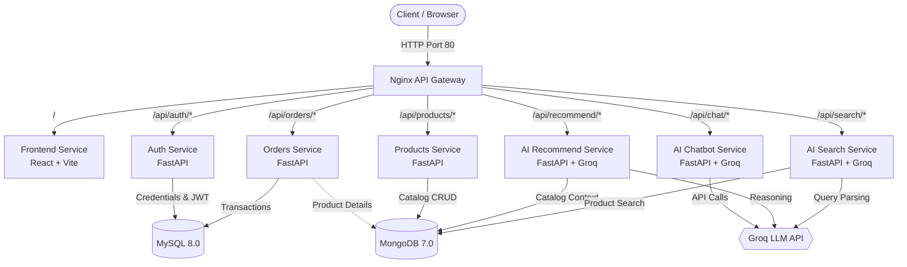

# 🛒 AI-Powered E-Commerce Microservices Platform

An enterprise-grade, cloud-native e-commerce platform built with a microservices architecture, featuring AI-driven capabilities powered by Groq, orchestrated with Docker & Kubernetes, and continuously delivered via GitHub Actions CI/CD.

---

## 🌟 Key Features

- **Microservices Architecture**: Independently deployable and scalable backend services built with FastAPI.
- **AI Shopping Assistant**: Conversational AI assistant ("ShopBot") powered by Groq LLM for real-time customer support and shopping advice.
- **AI Semantic Search & Smart Recommendations**: Natural language product discovery and tailored recommendations powered by LLMs and MongoDB.
- **Polyglot Persistence**: MySQL 8.0 for relational transactions (Auth & Orders) and MongoDB 7.0 for flexible catalog documents (Products).
- **Modern Responsive Frontend**: Single Page Application built with React 18, Vite, and React Router.
- **High-Performance API Gateway**: Nginx reverse proxy with gzip compression, keep-alive upstream connections, and rate-handling.
- **Production Kubernetes Ready**: Complete K8s manifests including Deployments, Services, ConfigMaps, Secrets, Ingress, PVCs, HPA (Horizontal Pod Autoscaler), and PDB (Pod Disruption Budget).
- **Automated CI/CD**: GitHub Actions workflow for testing, multi-service Docker container builds, and Docker Hub distribution.

---

## 🏗️ Architecture Overview



---

## 📦 Services & Ports

| Service | Technology | Internal Port | Host Port (Compose) | Gateway Route | Purpose |
| :--- | :--- | :--- | :--- | :--- | :--- |
| **API Gateway** | Nginx Alpine | 80 | `80` | `/` | Reverse proxy & unified routing |
| **Frontend** | React 18 + Vite | 80 | `3000` | `/` | Responsive e-commerce UI |
| **Auth** | FastAPI, MySQL, JWT, bcrypt | 8001 | `8001` | `/api/auth/` | User authentication & authorization |
| **Products** | FastAPI, MongoDB | 8002 | `8002` | `/api/products/` | Product catalog & categories |
| **Orders** | FastAPI, MySQL, MongoDB | 8003 | `8003` | `/api/orders/` | Order processing & history |
| **AI Chatbot** | FastAPI, Groq SDK | 8004 | `8004` | `/api/chat/` | ShopBot conversational concierge |
| **AI Recommend** | FastAPI, Groq SDK, MongoDB | 8005 | `8005` | `/api/recommend/` | AI-personalized product suggestions |
| **AI Search** | FastAPI, Groq SDK, MongoDB | 8006 | `8006` | `/api/search/` | Semantic natural-language search |
| **MySQL** | MySQL 8.0 | 3306 | `3307` | Internal | Users, accounts & order records |
| **MongoDB** | MongoDB 7.0 | 27017 | `27017` | Internal | Dynamic product catalog storage |

---

## 🛠️ Tech Stack

- **Backend**: Python 3.11, [FastAPI](https://fastapi.tiangolo.com/), Uvicorn, Pydantic, python-jose (JWT), passlib (Bcrypt)
- **Frontend**: [React 18](https://react.dev/), [Vite](https://vitejs.dev/), React Router DOM, Axios
- **Databases**: [MySQL 8.0](https://www.mysql.com/), [MongoDB 7.0](https://www.mongodb.com/)
- **AI / LLM**: [Groq Cloud SDK](https://console.groq.com/) (LLaMA 3 / GPT-OSS models)
- **Networking & Ingress**: [Nginx](https://nginx.org/)
- **Containerization & Orchestration**: [Docker](https://www.docker.com/), Docker Compose, [Kubernetes](https://kubernetes.io/)
- **CI/CD**: GitHub Actions

---

## 🚀 Getting Started with Docker Compose

### 1. Prerequisites
- [Docker](https://www.docker.com/products/docker-desktop/) (v20.10+)
- [Docker Compose](https://docs.docker.com/compose/) (v2.0+)
- A [Groq API Key](https://console.groq.com/keys)

### 2. Clone the Repository
```bash
git clone https://github.com/VIKASHL25/ai-ecommerce.git
cd ai-ecommerce
```

### 3. Configure Environment Variables
Create a `.env` file in the repository root:
```ini
GROQ_API_KEY=your_actual_groq_api_key_here
```

> ⚠️ **Note**: Never commit `.env` or files containing secret keys to Git. They are ignored in `.gitignore`.

### 4. Build and Run the Stack
```bash
docker compose up --build -d
```

### 5. Verify Running Containers
```bash
docker compose ps
```

### 6. Access the Application
- **Web Storefront**: [http://localhost](http://localhost) (or [http://localhost:3000](http://localhost:3000))
- **API Gateway**: [http://localhost/api/](http://localhost/api/)
- **Interactive API Docs (Swagger UI)**:
  - Auth Service: [http://localhost:8001/docs](http://localhost:8001/docs)
  - Products Service: [http://localhost:8002/docs](http://localhost:8002/docs)
  - Orders Service: [http://localhost:8003/docs](http://localhost:8003/docs)
  - AI Chatbot: [http://localhost:8004/docs](http://localhost:8004/docs)
  - AI Recommend: [http://localhost:8005/docs](http://localhost:8005/docs)
  - AI Search: [http://localhost:8006/docs](http://localhost:8006/docs)

### 7. Stop the Services
```bash
docker compose down
# To remove persistent volumes as well:
docker compose down -v
```

---

## ☸️ Kubernetes Deployment

All Kubernetes manifests are organized under the [`k8s/`](./k8s) directory.

### 1. Create Secrets & ConfigMaps
Create `k8s/secret.yaml` with your base64-encoded credentials or generate it via `kubectl`:
```bash
kubectl create secret generic ecom-secret \
  --from-literal=MYSQL_PASSWORD=rootpassword \
  --from-literal=MONGO_PASSWORD=rootpassword \
  --from-literal=JWT_SECRET=supersecretjwtkey123 \
  --from-literal=GROQ_API_KEY="your_groq_api_key"
```

Apply the ConfigMap:
```bash
kubectl apply -f k8s/configmap.yaml
```

### 2. Deploy Databases & Storage
```bash
kubectl apply -f k8s/mysql-pvc.yaml
kubectl apply -f k8s/mysql-deployment.yaml
kubectl apply -f k8s/mongo-pvc.yaml
kubectl apply -f k8s/mongo-deployment.yaml
```

### 3. Deploy Application Microservices
```bash
kubectl apply -f k8s/auth-deployment.yaml
kubectl apply -f k8s/products-deployment.yaml
kubectl apply -f k8s/orders-deployment.yaml
kubectl apply -f k8s/ai-deployment.yaml
kubectl apply -f k8s/frontend-deployment.yaml
kubectl apply -f k8s/gateway-deployment.yaml
```

### 4. Apply Ingress & Auto-Scaling
```bash
kubectl apply -f k8s/ingress.yaml
kubectl apply -f k8s/hpa.yaml
kubectl apply -f k8s/pdb.yaml
```

### 5. Check Cluster Status
```bash
kubectl get pods,svc,hpa,ingress
```

---

## 🔄 CI/CD Pipeline

The repository includes an automated GitHub Actions workflow defined in [`.github/workflows/cicd.yaml`](./.github/workflows/cicd.yaml):

1. **Job 1 (Test)**:
   - Sets up Python 3.11.
   - Executes unit tests for authentication logic (JWT encoding/decoding, password hashing).
   - Validates MongoDB serialization routines in the products service.
   - Tests Groq dependency integration.
2. **Job 2 (Build & Push)**:
   - Uses a build matrix across all 7 services.
   - Authenticates against Docker Hub.
   - Builds optimized multi-stage images using Docker Buildx and GitHub Actions layer caching.
   - Tags each image with `latest` and `${{ github.sha }}`.
3. **Job 3 (Summary)**:
   - Publishes a markdown summary to GitHub Step Summary with direct `kubectl set image` rollout commands.

### Required GitHub Secrets
To enable the pipeline, configure the following repository secrets under **Settings > Secrets and variables > Actions**:
- `DOCKER_USERNAME`: Your Docker Hub username.
- `DOCKER_PASSWORD`: Your Docker Hub Personal Access Token (PAT).

---

## 📂 Project Structure

```
ai-ecommerce/
├── .github/
│   └── workflows/
│       └── cicd.yaml             # GitHub Actions CI/CD pipeline
├── gateway/
│   └── nginx.conf                # API Gateway reverse proxy configuration
├── k8s/                          # Kubernetes manifests
│   ├── ai-deployment.yaml        # AI Chatbot, Search & Recommend deployments
│   ├── auth-deployment.yaml      # Auth service deployment & service
│   ├── configmap.yaml            # Shared cluster configurations
│   ├── frontend-deployment.yaml  # React frontend deployment & service
│   ├── gateway-deployment.yaml   # Nginx gateway deployment & service
│   ├── hpa.yaml                  # Horizontal Pod Autoscaling rules
│   ├── ingress.yaml              # Kubernetes Ingress configuration
│   ├── mongo-deployment.yaml     # MongoDB deployment & headless service
│   ├── mongo-pvc.yaml            # MongoDB PersistentVolumeClaim
│   ├── mysql-deployment.yaml     # MySQL deployment & service
│   ├── mysql-pvc.yaml            # MySQL PersistentVolumeClaim
│   ├── orders-deployment.yaml    # Orders service deployment & service
│   ├── pdb.yaml                  # Pod Disruption Budget
│   ├── products-deployment.yaml  # Products service deployment & service
│   └── secret.yaml.template      # Template for K8s secret configuration
├── services/
│   ├── ai-chatbot/               # ShopBot conversational assistant (FastAPI + Groq)
│   ├── ai-recommend/             # Intelligent recommendation engine (FastAPI + Groq)
│   ├── ai-search/                # Semantic natural language search (FastAPI + Groq)
│   ├── auth/                     # Authentication & JWT service (FastAPI + MySQL)
│   ├── frontend/                 # React 18 + Vite SPA storefront
│   ├── orders/                   # Order placement & transaction service (FastAPI)
│   └── products/                 # Product catalog & inventory service (FastAPI)
├── .env                          # Local environment variables (git-ignored)
├── .gitignore                    # Git ignore rules
├── docker-compose.yml            # Multi-service local orchestration
└── README.md                     # Project documentation
```

---

## 🛡️ Security & Best Practices

- **Secrets Handling**: Credentials and API keys (`.env`, `secret.yaml`) are strictly excluded from version control via `.gitignore`.
- **Stateless Services**: All microservices are designed stateless to support horizontal scaling (`HPA`).
- **Resilient Connectivity**: Services feature automated connection retry loops for backing datastores (MySQL/MongoDB) during cluster bootstrapping.
- **Zero-Trust Token Validation**: Endpoints authenticate incoming requests via cryptographically verified Bearer JWT tokens.

---


